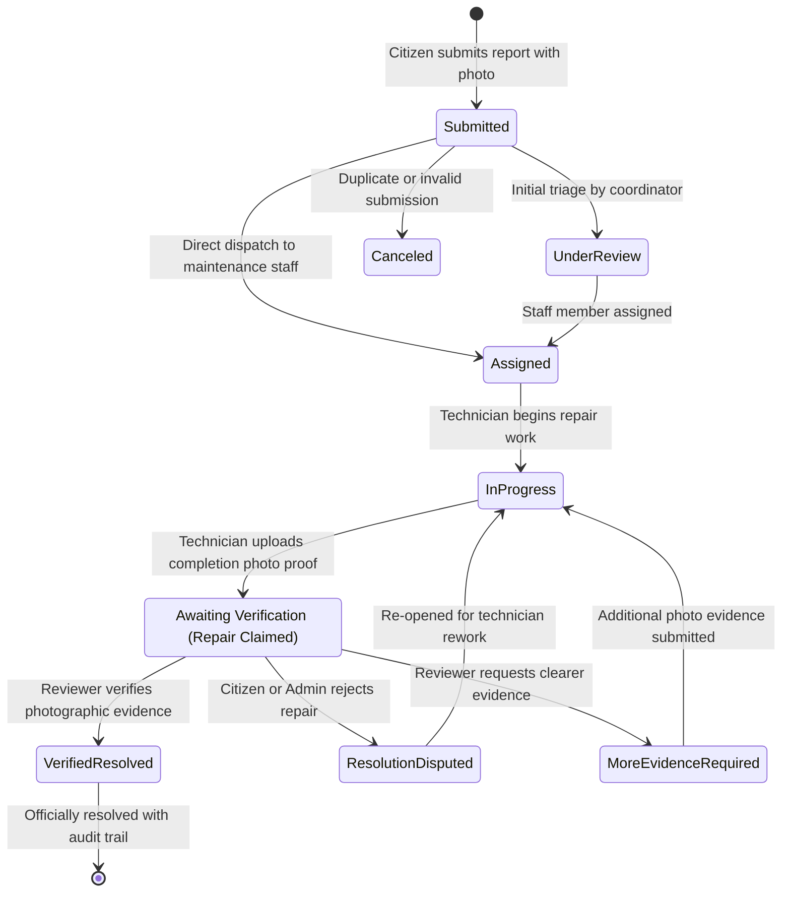

<div align="center">


# ProofBridge
### **From Reported Problems to Verified Outcomes.**

**An evidence-first civic and campus facility operations platform designed to eliminate the "closed ticket" illusion.**  
ProofBridge ensures maintenance repairs are backed by compulsory photographic proof, strict role-based privacy, transparent audit logging, and human-verified outcomes.

[](https://proofbridge-one.vercel.app/)
[](https://www.typescriptlang.org/)
[](https://reactjs.org/)
[](https://vitejs.dev/)
[](https://tailwindcss.com/)
[](https://www.mongodb.com/atlas)

[**Launch Live Application ↗**](https://proofbridge-one.vercel.app/) • [**System Architecture**](#-system-architecture--workflow-state-machine) • [**Role & Privacy Matrix**](#-role-separation--privacy-boundaries) • [**Quick Start**](#-getting-started-locally)

</div>

---

## 📌 Executive Overview & The Problem Space

In traditional municipal grievance and campus facility trackers, issues are routinely marked **"Resolved"** the moment a contractor or technician marks a task done—leaving citizens frustrated when streetlights remain dark, potholes remain unfilled, or repairs fail inspection.

```text
Traditional Ticket Model (Broken):
[ Report Filed ] ─────────────► [ Ticket Closed (No Proof) ] ──► (Discontent & Repeat Reports)

ProofBridge Model (Evidence-First):
[ Citizen Report + Photo ] ──► [ Work Started ] ──► [ Awaiting Verification + Photo Proof ] ──► [ Verified Resolved ]
```

> **The Verification Principle:** *Claimed Repair ≠ Verified Outcome.*  
> An issue cannot reach `Verified Resolved` without verifiable photographic evidence and human verification by an authorized reviewer.

---

## 🏛️ Core Pillars of ProofBridge

### 1. 📸 Compulsory Photographic Proof
Every repair requires timestamped visual evidence comparing the initial problem against the technician's completed work. Reviews are conducted side-by-side in the verification drawer to guarantee quality standards before closure.

### 2. 🛡️ Strict Role Separation & Reporter Privacy
- **Citizen / Reporter:** Submit geocoded issues with voice dictation and compressed photo attachments, track real-time resolution progress, and dispute unverified closures. **Strict Privacy Isolation** ensures each reporter only sees issues they personally reported—even after an issue is assigned to maintenance staff.
- **Maintenance Staff:** Field technician workspace to view all operational issues, claim assignments, log progress updates, and upload completion proof.
- **Higher Authority & Admin:** Multi-step authenticated command center to provision maintenance staff accounts, grant/revoke admin privileges, manage SLA queues, and grant final verification sign-offs.

### 3. 🔐 Zero-Leak Serverless & MongoDB Atlas Architecture
All credential verification, PBKDF2-SHA512 password hashing, 2-step OTP challenges, and database mutations execute inside **Vercel Serverless Functions** (`/api/authority`) backed by **MongoDB Atlas**. Master passwords, backup PINs, HMAC signing keys, and database URIs are never compiled into client JavaScript bundles.

### 4. ⚡ Instant Optimistic UI & Smart Media Compression
- **Client-Side Canvas Compression:** Uploaded evidence photos are automatically resized and compressed on the client prior to upload, keeping payloads lightweight and responsive.
- **Non-Blocking Cloud Synchronization:** Issue submissions and workflow transitions update the UI immediately and synchronize asynchronously with MongoDB Atlas.

---

## 🔄 System Architecture & Workflow State Machine

ProofBridge enforces an explicit deterministic state machine. Bypassing stages or force-closing issues without verification is architecturally prohibited.



---

## 👥 Role Separation & Privacy Boundaries

| Capability | Citizen Reporter | Maintenance Staff | Higher Authority / Admin |
| :--- | :---: | :---: | :---: |
| **Account Onboarding** | Self-registration + Cloud sync | Provisioned by Admin | Restricted 2-Step OTP Portal / Admin Grant |
| **Issue Visibility** | **Own reported issues only** | All active & assigned issues | Full global visibility across all queues |
| **Issue Reporting** | Photo + voice input + location | Read & operational updates | Full triage, logging & deletion |
| **Task Assignment** | Preserves original ownership in *My Reports* | Self-assign / Start work | Dispatch to any maintenance staff member |
| **Evidence Submission** | Initial complaint photo | Compulsory completion proof | Side-by-side inspection |
| **Dispute Filing** | Can contest false closures | — | Issues rework order |
| **Final Sign-Off** | — | — | Official Verification Authority |

---

## 🔒 Enterprise-Grade Security Architecture

ProofBridge is engineered with zero-trust boundaries between the browser and cloud persistence:

```text
┌──────────────────────────────────────────────┐
│  Client Application (React 18 / Vite 6)      │
│  - Zero plaintext passwords or secret keys   │
│  - Client-side photo compression             │
│  - Role-scoped view filtering                │
└──────────────────────┬───────────────────────┘
                       │ HTTPS JSON (/api/authority)
                       ▼
┌──────────────────────────────────────────────┐
│  Vercel Serverless Function (api/authority)  │
│  - Server-only process.env credentials       │
│  - PBKDF2-SHA512 password hashing            │
│  - crypto.timingSafeEqual secret comparison  │
│  - HMAC-SHA256 session tokens & OTP verify   │
│  - Per-IP rate limiting (15 req / min)       │
└──────────────────────┬───────────────────────┘
                       │ TLS Connection Pool
                       ▼
┌──────────────────────────────────────────────┐
│  MongoDB Atlas Cloud (proofbridge DB)        │
│  - users: Roles, PBKDF2 hashes, permissions  │
│  - issues: Reports, photos, timeline, proof  │
│  - challenges: Expiring 2-step OTP records   │
└──────────────────────────────────────────────┘
```

---

## 💻 Tech Stack

- **Frontend:** React 18.3, TypeScript 5.8, Vite 6.4
- **Styling & UI:** Tailwind CSS 3.4, PostCSS, Lucide React Icons
- **Serverless Backend:** Vercel Functions (`api/authority.ts`) on Node.js runtime
- **Cloud Database:** MongoDB Atlas (`mongodb` v7 driver with warm serverless connection pooling)
- **Resilience & Offline Fallback:** Automatic local state hydration when running offline or without cloud credentials

---

## 🚀 Getting Started Locally

### Prerequisites
- Node.js 18.x or 20.x+
- npm 9+
- A MongoDB Atlas cluster (optional for local offline mode; required for full cloud persistence)

### 1. Clone the Repository
```bash
git clone https://github.com/biswajitbiswal-in/proofBridge.git
cd proofBridge
```

### 2. Install Dependencies
```bash
npm install
```

### 3. Configure Environment Variables
Copy `.env.example` to `.env` and populate your credentials:
```bash
cp .env.example .env
```

```env
# 1. Public Client-Side Variables
VITE_AUTHORITY_FULL_NAME=Your Full Name
VITE_AUTHORITY_EMAIL=authority@yourorganization.com

# 2. Server-Only Secrets (Vercel Serverless Function /api/authority)
AUTHORITY_FULL_NAME=Your Full Name
AUTHORITY_EMAIL=authority@yourorganization.com
AUTHORITY_PASSWORD=YourStrongMasterPassword
AUTHORITY_BACKUP_PIN=Your6DigitPIN
AUTHORITY_SECRET_KEY=YourRandomHmacSigningSecret

# 3. Default Role Account Credentials (Server-Only)
ADMIN_FULL_NAME=Campus Coordinator
ADMIN_EMAIL=admin@yourorganization.com
ADMIN_PASSWORD=YourStrongAdminPassword

STAFF_FULL_NAME=Field Technician
STAFF_EMAIL=staff@yourorganization.com
STAFF_PASSWORD=YourStrongStaffPassword

REPORTER_FULL_NAME=Citizen Reporter
REPORTER_EMAIL=reporter@yourorganization.com
REPORTER_PASSWORD=YourStrongReporterPassword

# 4. MongoDB Atlas Cloud Database (Server-Only)
MONGODB_URI=mongodb+srv://<username>:<password>@<cluster>.mongodb.net/?retryWrites=true&w=majority&appName=proofBridge
MONGODB_DB=proofbridge
```

### 4. Start the Development Server
```bash
npm run dev
```
Open [http://localhost:5173](http://localhost:5173) in your browser.

### 5. Build for Production
```bash
npm run build
```

---

## 🌐 Production Deployment

ProofBridge is pre-configured with [`vercel.json`](./vercel.json) for deployment on **Vercel**:

- **Live Production URL:** [https://proofbridge-one.vercel.app/](https://proofbridge-one.vercel.app/)
- **Build Command:** `npm run build`
- **Output Directory:** `dist`
- **Serverless API Endpoint:** `/api/authority`

---

## 📁 Repository Structure

```text
proofBridge/
├── api/
│   └── authority.ts                  # Vercel Serverless API (Auth, OTP, Users & Issues CRUD)
├── docs/
│   ├── architecture.md               # System architecture & workflow specification
│   ├── prd.md                        # Product requirements document
│   └── problemstatement.md           # Problem statement & operational analysis
├── public/
│   └── logo.svg                      # ProofBridge vector brand emblem
├── src/
│   ├── components/
│   │   ├── IssueDetailDrawer.tsx     # Side-by-side photo proof & verification drawer
│   │   ├── ProofBridgeLogo.tsx       # Responsive SVG brand component
│   │   └── SecondaryViews.tsx        # Verification Queue, Disputes, SLA, Audit & Admin views
│   ├── services/
│   │   └── proofBridgeService.ts     # State machine, cloud sync client & role persistence
│   ├── types/
│   │   └── domain.ts                 # Core TypeScript interfaces, status & role definitions
│   ├── App.tsx                       # Main application shell, role portals & issue workflows
│   ├── index.css                     # Tailwind CSS layers & micro-interaction animations
│   └── main.tsx                      # React DOM entry point
├── .env.example                      # Safe template for required environment variables
├── vercel.json                       # Vercel routing & security headers configuration
└── package.json
```

---

## 👤 Author & Maintainer

**Biswajit Biswal**  
- **GitHub:** [@biswajitbiswal-in](https://github.com/biswajitbiswal-in)  
- **Live Production:** [https://proofbridge-one.vercel.app](https://proofbridge-one.vercel.app)

---

## 📄 License

This project is available for educational and civic innovation use under the **MIT License**.
