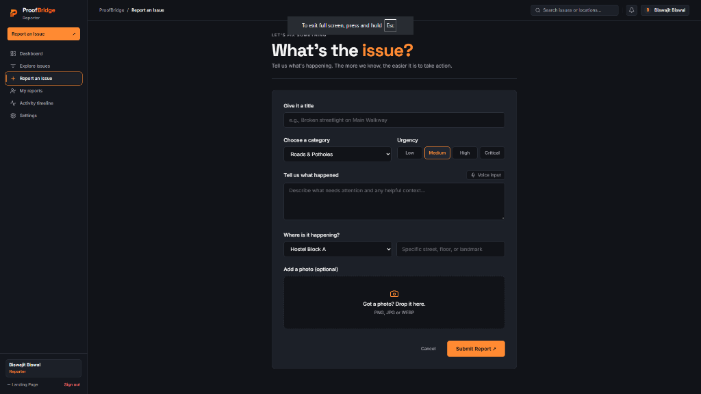
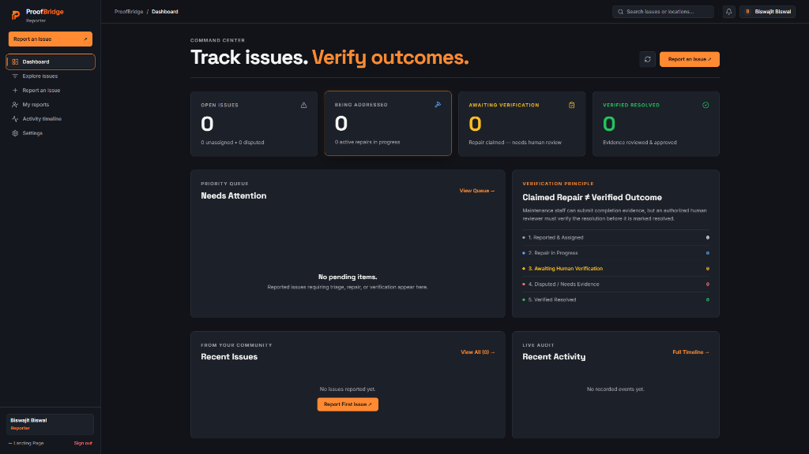
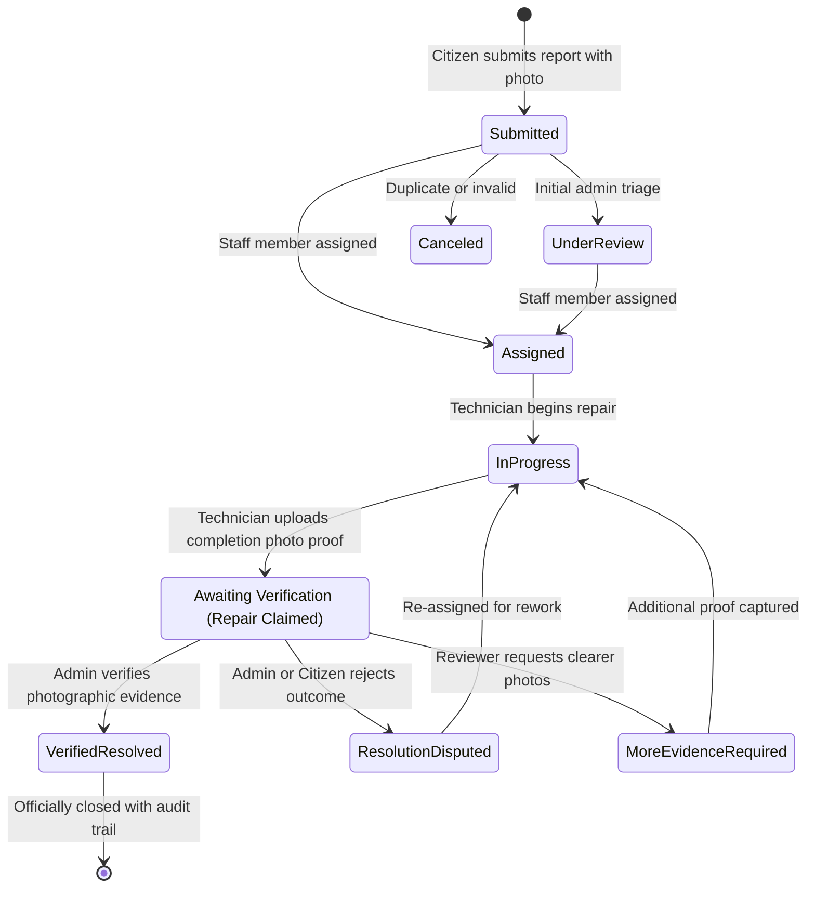

<div align="center">


# ProofBridge
### **From Reported Problems to Verified Outcomes.**

**The modern civic-tech & facility operations platform that eliminates the "closed ticket" illusion.**  
ProofBridge ensures campus, municipal, and facility repairs are backed by timestamped photographic evidence, transparent audit trails, and human-verified outcomes.

[](https://proofbridg.vercel.app/)
[](https://www.typescriptlang.org/)
[](https://reactjs.org/)
[](https://vitejs.dev/)
[](https://tailwindcss.com/)
[](https://supabase.com/)

[**🚀 Launch Live Web App**](https://proofbridg.vercel.app/) • [**Explore Features**](#-product-tour--visual-showcase) • [**System Architecture**](#-system-architecture--state-machine) • [**Quick Start**](#-getting-started-locally)

</div>

---

## 📌 The Problem: The "Closed Ticket" Illusion

In traditional issue tracking and municipal grievance systems, issues are routinely marked **"Resolved"** the moment a contractor or maintenance team clicks a button—even if the repair was never performed, was executed poorly, or broke down immediately after.

Citizens and students face:
- ❌ **Lack of Accountability:** Tickets are closed unilaterally with no proof of work.
- ❌ **Repetitive Complaints:** The same potholes, broken lights, and water leaks get reported repeatedly.
- ❌ **Broken Trust:** Administrators have zero visibility into whether field teams actually fixed the problem.

### 💡 The ProofBridge Solution
**Claimed Repair ≠ Verified Outcome.**  
ProofBridge introduces an evidence-first operational pipeline where field staff cannot simply mark an issue resolved. They must submit timestamped before-and-after photographic evidence, and an authorized reviewer must inspect the proof before the issue can transition to `Verified Resolved`.

---

## 📸 Product Tour & Visual Showcase

### 1. Public Community Watch & Civic Discovery
A high-performance editorial landing page featuring real-time civic impact metrics, public issue discovery, category filtering, and one-click reporting.


---

### 2. Frictionless Citizen Reporting
Designed for speed and ease: Citizens can submit reports with title, category, priority urgency tags, voice dictation input, specific campus/street location, and photo attachments.



---

### 3. Operations Command Center & Metric KPIs
A real-time administrative dashboard grouping issues into active operational buckets: **Open Issues**, **Being Addressed**, **Awaiting Verification**, and **Verified Resolved**, backed by a live audit trail.



---

### 4. Photographic Evidence Review & Side-by-Side Inspection
Administrators compare the original citizen complaint photo directly against the technician's completed repair photo before granting official sign-off or disputing the repair for rework.


---

## ⚡ Key Value Propositions

| Feature | Citizen Reporter | Maintenance Staff | Higher Authority Admin |
| :--- | :--- | :--- | :--- |
| **Account Access** | Public self-registration | Provisioned by Admin | Restricted 2-Step OTP Portal |
| **Issue Reporting** | Photo + voice input + location | — | Full triage & emergency logging |
| **Repair Workflow** | Live status tracking & dispute rights | Claim tasks, start work, log notes | Assign tasks & set SLAs |
| **Evidence Submission** | Initial report photo | Compulsory completion photo | Side-by-side verification |
| **Verification Authority** | Can dispute fraudulent repairs | Claims repair completion | Final approval or rework order |

---

## 🔄 System Architecture & State Machine

ProofBridge enforces an explicit deterministic state machine. No shortcuts or bypassing of stages are permitted.



---

## 🛡️ Enterprise-Grade Security & Zero Client Leakage

- **Edge Serverless Authority Isolation (`/api/authority`)**:
  - The Higher Authority Master Portal runs on dedicated **Vercel Serverless Functions**.
  - Master passwords, backup PINs, and administrative secrets are **never compiled into client JavaScript bundles**.
- **Cryptographic Timing-Safe Equality**:
  - Verification calls utilize `crypto.timingSafeEqual` to neutralize timing side-channel attacks.
- **Built-in Rate Limiting**:
  - Serverless protection prevents brute-force attempts on administrative 2-Step OTP logins (max 10 attempts/minute per IP).
- **Row-Level Security (RLS)**:
  - Supabase PostgreSQL policies strictly restrict update permissions to authorized role IDs.

---

## 💻 Tech Stack & Engineering Standards

- **Frontend Core:** React 18.3, TypeScript 5.7, Vite 6.0
- **Design System & Styling:** Tailwind CSS 3.4, PostCSS, Lucide React Icons
- **Backend & Edge:** Vercel Serverless Functions (`/api/authority`), Node.js runtime
- **Cloud Database & Auth:** Supabase (PostgreSQL 15, GoTrue Auth, Storage Buckets, RLS Policies)
- **Local Persistence Engine:** Deterministic, self-healing offline local store for dev & offline environments
- **Quality Assurance:** Unit test suites for state-machine validation and role boundary enforcement

---

## 🚀 Getting Started Locally

### Prerequisites
- Node.js 18.x or 20.x (LTS recommended)
- npm or pnpm

### 1. Clone the Repository
```bash
git clone https://github.com/biswajitbiswal-in/proofBridge.git
cd proofBridge
```

### 2. Install Dependencies
```bash
npm install
```

### 3. Setup Environment Variables
Create a local `.env` file based on `.env.example`:
```bash
cp .env.example .env
```

```env
# Client-side configuration
VITE_SUPABASE_URL=https://your-project.supabase.co
VITE_SUPABASE_ANON_KEY=your-anon-key
VITE_AUTHORITY_FULL_NAME=Biswajit Biswal
VITE_AUTHORITY_EMAIL=biswajitbiswal.in@gmail.com

# Server-only secrets (for local Node tests)
AUTHORITY_PASSWORD=YourStrongPassword
AUTHORITY_BACKUP_PIN=000000
```

### 4. Run Automated Test Suite
```bash
npm test
```
*Executes all state machine assertions, role boundary checks, and OTP verification tests.*

### 5. Start Local Development Server
```bash
npm run dev
```
Open your browser at **[http://127.0.0.1:5173/](http://127.0.0.1:5173/)**.

---

## 🌐 Production Deployment

ProofBridge is optimized for one-click deployment on **Vercel**:

1. **Push your code to GitHub:**
   ```bash
   git push origin main
   ```
2. **Import Project on [Vercel](https://vercel.com):**
   - Framework Preset: **Vite**
   - Build Command: `npm run build`
   - Output Directory: `dist`
3. **Configure Environment Variables in Vercel:**
   - **Public:** `VITE_SUPABASE_URL`, `VITE_SUPABASE_ANON_KEY`, `VITE_AUTHORITY_FULL_NAME`, `VITE_AUTHORITY_EMAIL`
   - **Server-Only (No `VITE_` prefix):** `AUTHORITY_PASSWORD`, `AUTHORITY_BACKUP_PIN`, `AUTHORITY_EMAIL`, `AUTHORITY_FULL_NAME`
4. **Live URL:** [https://proofbridg.vercel.app/](https://proofbridg.vercel.app/)

---

## 📂 Project Structure

```text
proofBridge/
├── api/
│   └── authority.ts               # Vercel Serverless Function (Master Auth & OTP)
├── docs/
│   ├── architecture.md            # Detailed system architecture & RLS specification
│   ├── prd.md                     # Product requirements document
│   └── screenshots/               # Visual product tour showcase
│       ├── landing-hero.png
│       ├── report-form.png
│       ├── dashboard-command-center.png
│       └── dashboard-evidence.png
├── src/
│   ├── components/
│   │   ├── IssueDetailDrawer.tsx  # Side-by-side evidence inspection drawer
│   │   ├── ProofBridgeLogo.tsx    # Responsive vector brand emblem
│   │   └── SecondaryViews.tsx     # Admin Console, Reviews, Timeline & Analytics
│   ├── lib/
│   │   └── supabase.ts            # Supabase cloud client & connection watchdog
│   ├── services/
│   │   └── proofBridgeService.ts  # State machine logic, operations & offline store
│   ├── types/
│   │   ├── domain.ts              # Data types, role enums, and status badges
│   │   ├── stateMachine.test.ts   # State transition unit tests
│   │   └── authAndRoleSeparation.test.ts # Role separation unit tests
│   ├── App.tsx                    # Master layout, navigation tabs & views
│   └── index.css                  # Design tokens, custom animations & keyframes
├── supabase/
│   └── schema.sql                 # PostgreSQL DDL, triggers & RLS policies
├── vercel.json                    # Single-page application rewrites & caching rules
└── package.json
```

---

## 👤 Author & Maintainer

**Biswajit Biswal**  
- **Live Platform:** [https://proofbridg.vercel.app/](https://proofbridg.vercel.app/)
- **GitHub:** [@biswajitbiswal-in](https://github.com/biswajitbiswal-in)
- **Contact:** [biswajitbiswal.in@gmail.com](mailto:biswajitbiswal.in@gmail.com)

---

## 📄 License

This project is licensed under the **MIT License**. See the [LICENSE](./LICENSE) file for details.
