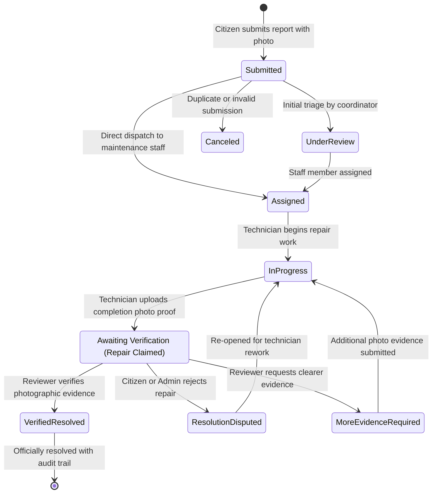

<div align="center">


# ProofBridge
### **From Reported Problems to Verified Outcomes.**

**An evidence-first civic and campus facility operations platform designed to eliminate the "closed ticket" illusion.**  
ProofBridge ensures maintenance repairs are backed by compulsory photographic proof, transparent audit logging, and human-verified outcomes.

[](https://proofbridge-one.vercel.app/)
[](https://www.typescriptlang.org/)
[](https://reactjs.org/)
[](https://vitejs.dev/)
[](https://tailwindcss.com/)
[](https://supabase.com/)

[**Launch Live Application ↗**](https://proofbridge-one.vercel.app/) • [**System Architecture**](#-system-architecture--workflow-state-machine) • [**Role Matrix**](#-three-tier-role-separation) • [**Quick Start**](#-getting-started-locally)

</div>

---

## 📌 Executive Overview & The Problem Space

In traditional municipal grievance and campus facility trackers, issues are routinely marked **"Resolved"** the moment a contractor or technician marks a task done—leaving citizens frustrated when streetlights remain dark, potholes remain unfilled, or repairs fail inspection.

```
Traditional Ticket Model (Broken):
[ Report Filed ] ─────────────► [ Ticket Closed (No Proof) ] ──► (Discontent & Repeat Reports)

ProofBridge Model (Evidence-First):
[ Citizen Report + Photo ] ──► [ Work Started ] ──► [ Awaiting Verification + Photo Proof ] ──► [ Verified Resolved ]
```

> **The Verification Principle:** *Claimed Repair ≠ Verified Outcome.*  
> An issue cannot reach `Verified Resolved` without verifiable photographic evidence and human verification by an authorized reviewer.

---

## 🏛️ The Four Pillars of ProofBridge

### 1. 📸 Compulsory Photographic Proof
Every repair requires timestamped visual evidence comparing the initial problem against the technician's completed work. Reviews are conducted side-by-side to guarantee quality standards.

### 2. 🛡️ Strict Three-Tier Role Separation
- **Citizen / Reporter:** Submit geocoded issues with voice dictation and photo attachments, track real-time resolution progress, and dispute fraudulent closures.
- **Maintenance Staff:** Field technician dashboard to claim assignments, log progress updates, and upload completion proof.
- **Higher Authority Admin:** Multi-step authenticated command center to provision staff accounts, manage SLA queues, and grant final verification sign-offs.

### 3. 🔐 Zero-Leak Serverless Security
Administrative credential verification and 2-step OTP challenges are isolated entirely on **Vercel Serverless Functions** (`/api/authority`). Passwords, backup PINs, and administrative secrets are never compiled into client JavaScript bundles.

### 4. ⚡ 60fps Micro-Interactions & Fluid Design
Built with modern design aesthetics: GPU-accelerated Tailwind transitions, card elevation hover states, live status radar dots, and smooth drawer workflows—fully compliant with accessibility (`prefers-reduced-motion`) standards.

---

## 🔄 System Architecture & Workflow State Machine

ProofBridge enforces an explicit deterministic state machine. Bypassing stages or force-closing issues without verification is architecturally prohibited.



---

## 👥 Three-Tier Role Separation

| Capability | Citizen Reporter | Maintenance Staff | Higher Authority Admin |
| :--- | :---: | :---: | :---: |
| **Account Onboarding** | Public self-registration | Provisioned by Admin | Restricted 2-Step OTP Portal |
| **Issue Reporting** | Photo + voice input + location | Read-only | Full triage & logging |
| **Task Claiming** | — | Self-assign / Start work | Dispatch to any staff member |
| **Evidence Submission** | Initial complaint photo | Compulsory completion proof | Side-by-side inspection |
| **Dispute Filing** | Can contest false claims | — | Issues rework order |
| **Final Sign-Off** | — | — | Official Verification Authority |

---

## 🔒 Enterprise-Grade Security Architecture

ProofBridge is engineered with zero-trust architectural boundaries:

```
┌──────────────────────────────────────┐
│  Client Application (Vite / React)   │
│  - Zero administrative secrets       │
│  - Zero master passwords in bundle   │
└──────────────────┬───────────────────┘
                   │ POST /api/authority
                   ▼
┌──────────────────────────────────────┐
│  Vercel Serverless Function Edge     │
│  - Node.js runtime environment       │
│  - Server-only process.env secrets   │
│  - crypto.timingSafeEqual comparison │
│  - IP-based rate limiting (10/min)   │
└──────────────────┬───────────────────┘
                   │
                   ▼
┌──────────────────────────────────────┐
│  Supabase Cloud (PostgreSQL 15)      │
│  - Row-Level Security (RLS) policies │
│  - Encrypted storage buckets         │
└──────────────────────────────────────┘
```

---

## 💻 Tech Stack & Engineering Standards

- **Frontend Core:** React 18.3, TypeScript 5.7, Vite 6.0
- **Styling System:** Tailwind CSS 3.4, PostCSS, Lucide React Icons
- **Edge Backend:** Vercel Serverless Functions (`/api/authority`) on Node.js runtime
- **Cloud Database & Auth:** Supabase (PostgreSQL 15, Storage Buckets, GoTrue Auth, Row-Level Security)
- **Local Persistence Engine:** Deterministic, self-healing local database fallback for development and offline intranets
- **Quality Assurance:** Unit test suites for state-machine validation and role boundary enforcement

---

## 🚀 Getting Started Locally

### Prerequisites
- Node.js 18.x or 20.x (LTS recommended)
- npm or pnpm

### 1. Clone the Repository
```bash
git clone https://github.com/biswajitbiswal-in/proofBridge.git
cd proofBridge
```

### 2. Install Dependencies
```bash
npm install
```

### 3. Setup Environment Variables
Create a local `.env` file based on `.env.example`:
```bash
cp .env.example .env
```

```env
# Client-side configuration
VITE_SUPABASE_URL=https://your-project.supabase.co
VITE_SUPABASE_ANON_KEY=your-anon-key
VITE_AUTHORITY_FULL_NAME=Your Full Name
VITE_AUTHORITY_EMAIL=authority@yourorganization.com

# Server-only secrets (for local Node tests)
AUTHORITY_PASSWORD=YourStrongPassword
AUTHORITY_BACKUP_PIN=Your6DigitPIN
```

### 4. Run Automated Test Suite
```bash
npm test
```
*Verifies all state machine transitions, role separation boundaries, and OTP authentication flows.*

### 5. Launch Development Server
```bash
npm run dev
```
Open [http://127.0.0.1:5173/](http://127.0.0.1:5173/) in your browser.

---

## 🌐 Production Deployment

ProofBridge is configured with [`vercel.json`](./vercel.json) for one-click deployment to **Vercel**:

- **Production URL:** [https://proofbridge-one.vercel.app/](https://proofbridge-one.vercel.app/)
- **Build Command:** `npm run build`
- **Output Directory:** `dist`
- **Serverless API Routes:** `/api/authority`

---

## 📁 Repository Structure

```text
proofBridge/
├── api/
│   └── authority.ts               # Vercel Serverless Function (Master Auth & OTP)
├── docs/
│   ├── architecture.md            # System architecture & database specification
│   ├── prd.md                     # Product requirements document
│   └── problemstatement.md       # Problem statement & operational analysis
├── src/
│   ├── components/
│   │   ├── IssueDetailDrawer.tsx  # Evidence verification modal drawer
│   │   ├── ProofBridgeLogo.tsx    # Responsive vector brand emblem
│   │   └── SecondaryViews.tsx     # Admin Console, Reviews, Timeline & Analytics
│   ├── lib/
│   │   └── supabase.ts            # Supabase cloud client & watchdog
│   ├── services/
│   │   └── proofBridgeService.ts  # State machine logic, operations & offline store
│   ├── types/
│   │   ├── domain.ts              # Data types, role enums, and status badges
│   │   ├── stateMachine.test.ts   # State transition unit tests
│   │   └── authAndRoleSeparation.test.ts # Role boundary unit tests
│   ├── App.tsx                    # Master layout, navigation tabs & views
│   └── index.css                  # Design tokens, custom animations & keyframes
├── supabase/
│   └── schema.sql                 # PostgreSQL DDL, triggers & RLS policies
├── vercel.json                    # SPA routing rules & immutable caching
└── package.json
```

---

## 👤 Author & Maintainer

**Biswajit Biswal**  
- **Live Application:** [https://proofbridge-one.vercel.app/](https://proofbridge-one.vercel.app/)  
- **GitHub:** [@biswajitbiswal-in](https://github.com/biswajitbiswal-in)  
- **Live Production:** [https://proofbridge-one.vercel.app](https://proofbridge-one.vercel.app)

---

## 📄 License

This project is licensed under the **MIT License**. See the [LICENSE](./LICENSE) file for details.
