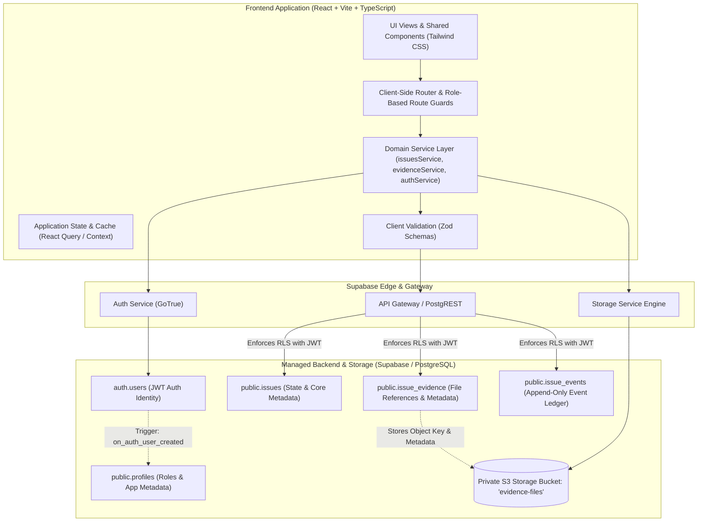
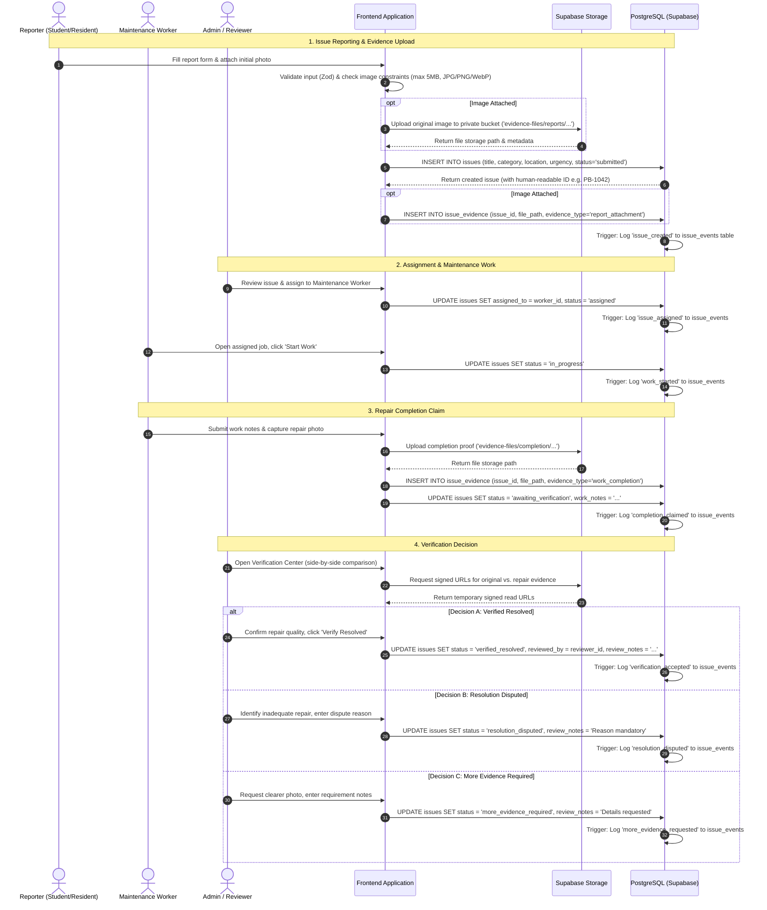
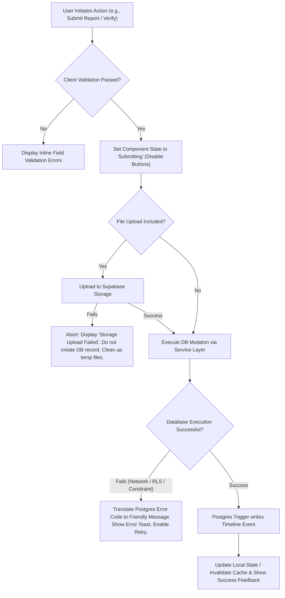
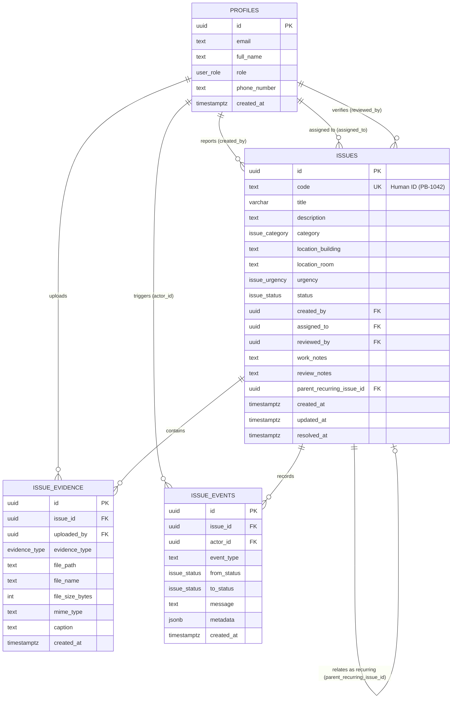
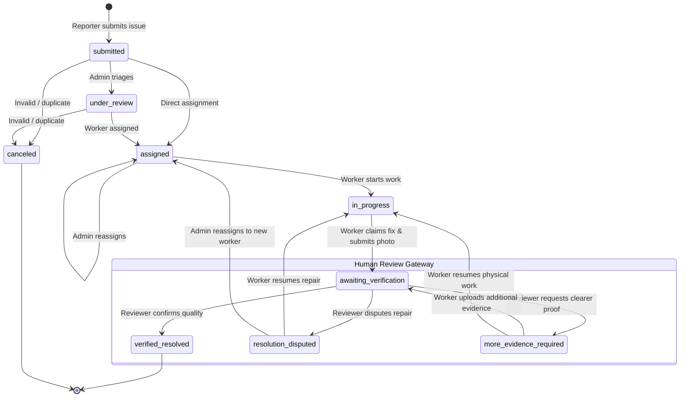
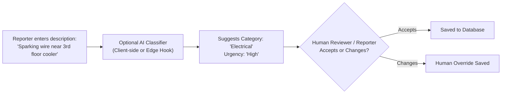
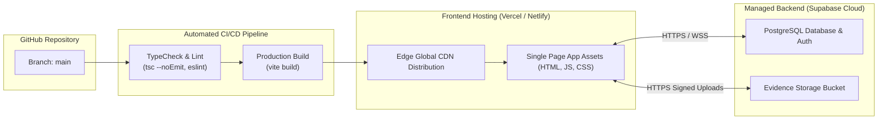
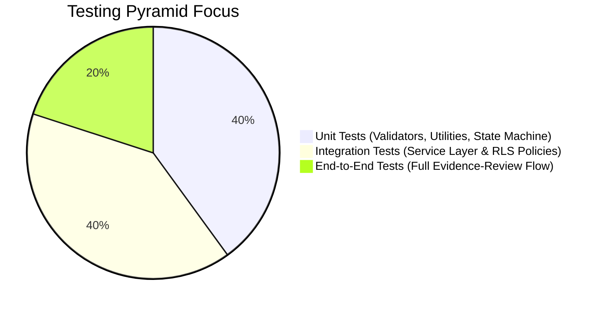
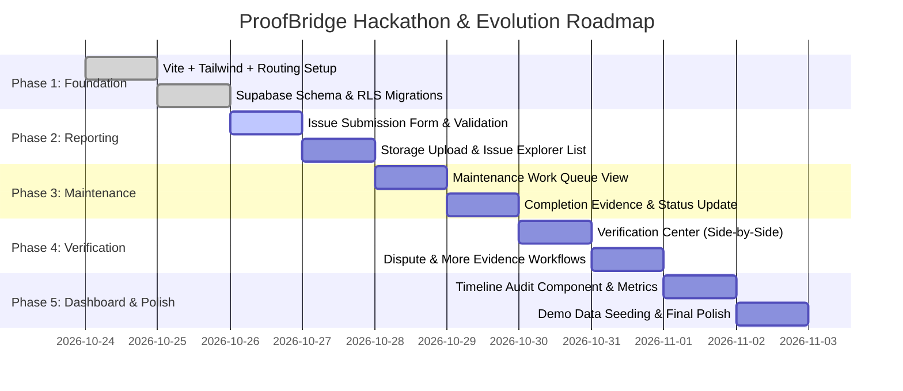

# ProofBridge — System Architecture Document

**Document Status:** Architecture Baseline for Hackathon MVP & Production Evolution  
**Project Name:** ProofBridge  
**Tagline:** From reported problems to verified outcomes.  
**Source of Truth:** [`prd.md`](docs/prd.md) and [`problemstatement.md`](docs/problemstatement.md)  
**Target Environment:** Colleges, student hostels, and shared institutional facilities  

---

## 1. Architecture Overview

### 1.1 Architectural Philosophy and Pattern
ProofBridge is built as a **modular, client-centric monolithic web application** backed by a **BaaS (Backend-as-a-Service) platform (Supabase / Managed PostgreSQL)**. 

The architecture avoids premature distributed systems (microservices, service meshes, message brokers) while enforcing strict domain separation at the application layer and database boundary. This ensures:
1. **Rapid hackathon velocity:** No custom backend boilerplate, instant zero-latency RESTful and real-time APIs generated directly from the PostgreSQL schema.
2. **Robust data integrity:** Core business rules (state machine transitions, relational foreign keys, timestamps, audit logging) are validated and enforced at the PostgreSQL database level using triggers, constraints, and Row Level Security (RLS).
3. **Evidence-first auditability:** All issue events (creation, assignment, progress updates, evidence submissions, verification reviews) are stored in an append-only timeline table to guarantee traceability.
4. **Clean evolutionary path:** The frontend service layer abstracts Supabase SDK interactions behind strongly typed interfaces. If the platform scales to require custom Node.js/Go backend services in the future, the frontend business logic remains decoupled.

### 1.2 System Component Responsibilities

| Component | Technology | Primary Responsibilities |
|---|---|---|
| **Client / Frontend** | React 18+ / Vite / TypeScript | User interface, state management, form validation, client-side image compression & pre-validation, role-based view routing, and calling the service layer. |
| **Authentication** | Supabase Auth (GoTrue) | JWT issuance and validation, user registration/login, session persistence, secure storage of auth tokens, role propagation to Postgres session context (`auth.uid()`). |
| **API & Data Access** | PostgREST (Supabase Client) | Auto-generated RESTful API directly mapped to PostgreSQL tables and views, respecting Row Level Security (RLS) policies. |
| **Relational Database** | PostgreSQL 15+ | Relational schema storage, data constraints, check constraints, foreign keys, triggers for status transition validation, audit log generation, and full-text search indexing. |
| **Evidence Storage** | Supabase Storage (S3-compatible) | Private object storage bucket (`evidence-files`), secure upload handling, client-side signed URL retrieval for restricted media access. |
| **Realtime Engine (Optional)** | Supabase Realtime (Elixir/Phoenix) | PostgreSQL WAL (Write-Ahead Logging) change capture over WebSockets for live status updates in the Maintenance Workspace and Verification Center. |

---

### 1.3 High-Level System Architecture Diagram



---

### 1.4 End-to-End Data Flow: From Creation to Verification

The entire issue lifecycle flows through a controlled sequence of operations across the frontend, database, and object storage:



---

## 2. Recommended Technology Stack

ProofBridge utilizes a modern, minimal, and battle-tested stack specifically tuned for hackathon execution speed without sacrificing long-term software engineering rigor.

| Layer | Selected Tool | Justification & Hackathon Fit |
|---|---|---|
| **Frontend Framework** | **React 18 + Vite** | Standard, high-performance frontend build tooling. Hot Module Replacement (HMR) speeds up development, and React's ecosystem allows rapid UI iteration. |
| **Programming Language** | **TypeScript** | Strict compile-time typing prevents runtime null pointer errors, guarantees schema alignment between the database and UI, and documents domain models naturally. |
| **Styling System** | **Tailwind CSS** | Utility-first CSS provides maximum design control, eliminates CSS file bloat, and enables fast UI construction with rich design tokens, dark mode, and responsive classes. |
| **Component Icons** | **Lucide React** | Clean, consistent, tree-shakeable SVG icons covering all domain entities (camera, alert, shield-check, clock, user, hammer). |
| **Backend & Database** | **Supabase (PostgreSQL 15)** | Delivers a production-grade relational database with automatic REST APIs, built-in connection pooling, instant schema migrations, and enterprise-grade Row Level Security. |
| **Authentication** | **Supabase Auth** | Built-in email/password and magic link authentication. Injects current user claims directly into PostgreSQL session contexts for RLS checks. |
| **Media & Object Storage** | **Supabase Storage** | S3-compatible managed object store. Enforces bucket-level RLS policies and generates secure, time-limited signed URLs for evidence retrieval. |
| **Analytics & Visualization** | **Recharts** | Lightweight, composable React charting library built on SVG. Used strictly where beneficial: Issue Volume by Category, Resolution Dispute Rates, and Overdue Trends. |
| **Source Control** | **Git & GitHub** | Distributed version control, pull requests, and automated continuous deployment hooks. |
| **Frontend Hosting** | **Vercel / Netlify** | Zero-configuration edge deployment, instant preview environments for pull requests, automated SSL, and sub-second asset distribution via CDN. |
| **Backend Hosting** | **Supabase Cloud** | Managed database infrastructure with daily backups, automated connection pooling, and integrated web dashboard for schema inspection. |

### Technologies Explicitly Excluded
* **No Kubernetes / Docker Swarm:** Massive operational overhead with zero benefit for an MVP.
* **No Custom Express / NestJS microservices:** Writing manual CRUD endpoints duplicates PostgREST's capabilities and introduces unnecessary API maintenance friction.
* **No Blockchain / Distributed Ledgers:** ProofBridge's PRD establishes that institutional facility tracking requires operational auditability and fast relational querying, not decentralized proof-of-work/stake consensus. Cryptographic hashing can be applied to file storage without blockchain overhead.
* **No Autonomous AI Decision Engine:** PRD Non-Goal: AI must never automatically verify repairs or close issues.

---

## 3. Frontend Architecture

### 3.1 Folder Structure
ProofBridge uses a **feature-based architecture**. Code is grouped by domain feature rather than technical file type, keeping related components, hooks, services, and types co-located for maintainability.

```text
proofBridge/
├── .env.example
├── .gitignore
├── index.html
├── package.json
├── postcss.config.js
├── tailwind.config.js
├── tsconfig.json
├── vite.config.ts
├── docs/
│   ├── prd.md
│   └── problemstatement.md
├── src/
│   ├── main.tsx                         # React application bootstrapping
│   ├── App.tsx                          # App root with Providers & Main Layout shell
│   ├── routes.tsx                       # React Router configuration with Route Guards
│   │
│   ├── assets/                          # Static imagery, logos, and global SVGs
│   ├── styles/                          # Global CSS and Tailwind directives
│   │   └── index.css
│   │
│   ├── config/                          # App-wide configuration & environment bindings
│   │   ├── env.ts                       # Typed environment variables validation
│   │   └── constants.ts                 # Enums, categories, urgency levels, status colors
│   │
│   ├── lib/                             # Third-party library initializations
│   │   └── supabase.ts                  # Supabase client singleton
│   │
│   ├── types/                           # Global TypeScript declarations
│   │   ├── database.types.ts            # Auto-generated Supabase database types
│   │   ├── domain.ts                    # Core business models (Issue, Evidence, Timeline)
│   │   └── auth.ts                      # User profile and session types
│   │
│   ├── services/                        # Service layer (Database & Storage API calls)
│   │   ├── issuesService.ts             # Issue CRUD, assignments, status transitions
│   │   ├── evidenceService.ts           # File upload, validation, signed URL generation
│   │   ├── timelineService.ts           # Activity history retrieval
│   │   ├── analyticsService.ts          # Aggregate query metrics for Dashboard
│   │   └── recurringService.ts          # Potential duplicate / recurring issue queries
│   │
│   ├── hooks/                           # Reusable application hooks
│   │   ├── useAuth.ts                   # Auth session, role extraction, sign-in/out
│   │   ├── useDebounce.ts               # Search and filter input debouncing
│   │   └── useToast.ts                  # User notification dispatch
│   │
│   ├── components/                      # Shared, reusable atomic UI components
│   │   ├── ui/                          # Design-system primitives (no business logic)
│   │   │   ├── Button.tsx
│   │   │   ├── Input.tsx
│   │   │   ├── Select.tsx
│   │   │   ├── Badge.tsx                # Status & Urgency color-coded badges
│   │   │   ├── Modal.tsx
│   │   │   ├── Card.tsx
│   │   │   ├── Skeleton.tsx             # Loading placeholders
│   │   │   └── Toast.tsx
│   │   ├── layout/                      # Navigation and page layout containers
│   │   │   ├── Navbar.tsx
│   │   │   ├── Sidebar.tsx
│   │   │   ├── PageHeader.tsx
│   │   │   └── ProtectedRoute.tsx       # Role-based route authorization guard
│   │   └── feedback/                    # Standardized error and empty states
│   │       ├── EmptyState.tsx
│   │       └── ErrorBoundary.tsx
│   │
│   └── features/                        # Feature-driven business modules
│       ├── auth/                        # Login, Registration, Demo Role Switcher
│       │   ├── components/LoginForm.tsx
│       │   ├── components/DemoRoleBar.tsx # Clearly labelled hackathon role switcher
│       │   └── pages/LoginPage.tsx
│       │
│       ├── issues-report/               # Issue Reporting Module
│       │   ├── components/ImageUploadZone.tsx
│       │   ├── components/LocationSelector.tsx
│       │   ├── components/UrgencyRadioGroup.tsx
│       │   └── pages/ReportIssuePage.tsx
│       │
│       ├── issues-explorer/             # Filterable Issue List
│       │   ├── components/IssueFilterBar.tsx
│       │   ├── components/IssueTable.tsx
│       │   ├── components/IssueCard.tsx # Responsive mobile card
│       │   └── pages/IssuesExplorerPage.tsx
│       │
│       ├── issue-detail/                # Detailed View & Timeline
│       │   ├── components/IssueSummaryCard.tsx
│       │   ├── components/EvidenceViewer.tsx # Before/After comparison
│       │   ├── components/ActivityTimeline.tsx
│       │   └── pages/IssueDetailPage.tsx
│       │
│       ├── maintenance/                 # Worker Workspace
│       │   ├── components/WorkQueueList.tsx
│       │   ├── components/WorkUpdateModal.tsx
│       │   └── pages/MaintenancePage.tsx
│       │
│       ├── verification/                # Authorized Reviewer Verification Center
│       │   ├── components/VerificationCard.tsx
│       │   ├── components/DecisionDialog.tsx # Verify, Dispute, Request Evidence
│       │   └── pages/VerificationCenterPage.tsx
│       │
│       ├── recurring/                   # P1: Recurring & Duplicate Suggestions
│       │   ├── components/RecurringAlertBanner.tsx
│       │   └── components/LinkIncidentModal.tsx
│       │
│       ├── dashboard/                   # Institutional Metrics & Charts
│       │   ├── components/StatWidget.tsx
│       │   ├── components/CategoryBreakdownChart.tsx
│       │   ├── components/ResolutionTimeChart.tsx
│       │   └── pages/DashboardPage.tsx
│       │
│       └── settings/                    # Facility & Category Configuration
│           └── pages/SettingsPage.tsx
```

### 3.2 Responsibility of Major Layers and Component Communication
1. **Presentational Components (`/components/ui/`):** Completely stateless. They receive data through props and emit events via callbacks.
2. **Feature Components (`/features/*/components/`):** Assemble UI primitives to represent business interactions (e.g., submitting a repair with proof).
3. **Route Pages (`/features/*/pages/`):** Act as orchestrators. They call custom hooks or the service layer to fetch data, handle loading/error states, and render feature components.
4. **Service Layer (`/services/`):** The single source of truth for backend communication. Components never make direct PostgREST or Supabase SDK calls inside their rendering logic. This guarantees separation of concerns and facilitates unit testing with mocks.

---

## 4. Backend and Data Flow

### 4.1 Backend Engine: Supabase & PostgreSQL
Rather than running an intermediate custom web server for basic CRUD operations, ProofBridge utilizes PostgreSQL as an active application engine via Supabase:
* **PostgREST:** Maps database tables, views, and stored functions directly into secure, filtered HTTP endpoints.
* **Row Level Security (RLS):** Evaluates every database query against the authenticated user's ID and role.
* **PostgreSQL Triggers & Stored Procedures:** Enforce business integrity (e.g., generating human-readable IDs like `PB-1042`, preventing illegal state transitions, and auto-writing audit log entries).

### 4.2 Step-by-Step Backend Execution Workflows

#### 1. User Authentication
* User logs in via `supabase.auth.signInWithPassword()` or selects a demo profile.
* Supabase returns a JWT containing user claims (`sub: user_id`, `role: authenticated`).
* The frontend sets the auth session. The database trigger on `auth.users` ensures a linked row in `public.profiles` exists with the user's role (`reporter`, `maintenance`, `admin`).

#### 2. Submitting a New Issue with Optional Evidence
1. **Form Input:** Reporter submits title, description, category, location, and urgency.
2. **Image Upload (if present):**
   * Client checks file MIME type (`image/jpeg`, `image/png`, `image/webp`) and size (≤ 5MB).
   * Generates a unique storage path: `reports/{issue_uuid}/{timestamp}_{filename}`.
   * Uploads file to the private bucket `evidence-files`.
3. **Database Insertion:**
   * Inserts into `public.issues`.
   * Database trigger executes `generate_issue_code()` to assign a unique human-friendly ID (e.g. `PB-1042`).
   * If an image was uploaded, inserts a row into `public.issue_evidence` referencing the storage path and setting `evidence_type = 'report_attachment'`.
   * A trigger on `public.issues` automatically creates an entry in `public.issue_events` with `event_type = 'created'`.

#### 3. Assigning the Issue
* An administrator or coordinator selects an issue and assigns a maintenance staff member.
* Service calls `assignIssue(issueId, staffId)`.
* Database updates `issues.assigned_to = staffId` and `issues.status = 'assigned'`.
* Database trigger inserts an `issue_assigned` event into `issue_events`.

#### 4. Work Execution & Completion Claim
1. Maintenance worker changes status to `in_progress`.
2. Upon completing the fix, worker captures completion photo and enters repair notes.
3. Client uploads image to `evidence-files` with prefix `completion/{issue_uuid}/...`.
4. Client creates an `issue_evidence` record with `evidence_type = 'work_completion'`.
5. Worker invokes `requestVerification()`. Status moves strictly to `awaiting_verification`.
6. **Critical Guarantee:** The system prohibits the worker from transitioning the issue to `verified_resolved`.

#### 5. Reviewer Verification Decision
1. Reviewer navigates to `/verification`.
2. The UI renders the original issue report, original photo, worker repair notes, and completion photo side-by-side.
3. Reviewer selects one of three explicit paths:
   * **`Verified Resolved`:** Status changes to `verified_resolved`. Reviewer identity and timestamp recorded. Issue closed.
   * **`Resolution Disputed`:** Mandatory dispute reason required. Status reverts to `resolution_disputed`. Assigned worker is notified that additional work is required.
   * **`More Evidence Required`:** Mandatory requirement notes required. Status reverts to `more_evidence_required`. Assigned worker is prompted to provide clearer photographic proof.
4. Every decision generates an immutable record in `issue_events`.

### 4.3 Resilience, Loading States, and Error Handling



* **Optimistic vs. Pessimistic Updates:** Crucial state transitions (verification decisions, work assignments) use **pessimistic updates** with clear loading spinners to prevent split-brain UI states.
* **Storage Upload Rollback:** If an image upload succeeds but the subsequent database insert fails, the frontend service triggers an asynchronous deletion of the orphaned file in storage.
* **Idempotency:** Action buttons (e.g. `Submit Issue`, `Confirm Verification`) are immediately disabled upon click to prevent double-submissions caused by repeated clicks.

---

## 5. Database Schema

### 5.1 Architecture Decision: Assignment Modeling
> **Trade-Off Analysis:** In large enterprise systems, assignments are often split into a separate many-to-many `issue_assignments` table to track assignment delegations and shift handoffs. For the ProofBridge Hackathon MVP, assigning an issue directly via an `assigned_to` foreign key column on the `issues` table is chosen.  
> **Rationale:** 95% of facility tickets have exactly one active worker at any given time. Historical reassignments are faithfully preserved in the append-only `issue_events` table, avoiding unnecessary join complexity while preserving complete historical auditability.

### 5.2 PostgreSQL DDL & Table Specifications

```sql
-- Enable UUID extension
CREATE EXTENSION IF NOT EXISTS "uuid-ossp";

-- Sequence for human-readable issue codes (PB-1001, PB-1002, ...)
CREATE SEQUENCE IF NOT EXISTS issue_code_seq START 1001;

-- ==========================================
-- 1. PROFILES (Extends Supabase auth.users)
-- ==========================================
CREATE TYPE user_role AS ENUM ('reporter', 'maintenance', 'admin');

CREATE TABLE public.profiles (
    id UUID PRIMARY KEY REFERENCES auth.users(id) ON DELETE CASCADE,
    email TEXT NOT NULL UNIQUE,
    full_name TEXT NOT NULL,
    role user_role NOT NULL DEFAULT 'reporter',
    phone_number TEXT,
    created_at TIMESTAMPTZ NOT NULL DEFAULT timezone('utc'::text, now()),
    updated_at TIMESTAMPTZ NOT NULL DEFAULT timezone('utc'::text, now())
);

-- ==========================================
-- 2. ISSUES (Core problem records)
-- ==========================================
CREATE TYPE issue_status AS ENUM (
    'submitted',
    'under_review',
    'assigned',
    'in_progress',
    'awaiting_verification',
    'resolution_disputed',
    'more_evidence_required',
    'verified_resolved',
    'canceled'
);

CREATE TYPE issue_urgency AS ENUM ('low', 'medium', 'high', 'critical');

CREATE TYPE issue_category AS ENUM (
    'electrical',
    'plumbing',
    'hvac',
    'furniture_civil',
    'sanitation',
    'safety_grounds',
    'other'
);

CREATE TABLE public.issues (
    id UUID PRIMARY KEY DEFAULT uuid_generate_v4(),
    code TEXT NOT NULL UNIQUE, -- Human-readable identifier e.g., 'PB-1042'
    title VARCHAR(150) NOT NULL,
    description TEXT NOT NULL,
    category issue_category NOT NULL,
    location_building TEXT NOT NULL,
    location_room TEXT,
    urgency issue_urgency NOT NULL DEFAULT 'medium',
    status issue_status NOT NULL DEFAULT 'submitted',
    
    -- Actors
    created_by UUID NOT NULL REFERENCES public.profiles(id),
    assigned_to UUID REFERENCES public.profiles(id),
    reviewed_by UUID REFERENCES public.profiles(id),
    
    -- Resolution and Review Notes
    work_notes TEXT,
    review_notes TEXT,
    
    -- Linkage for confirmed recurring issues (self-referencing FK)
    parent_recurring_issue_id UUID REFERENCES public.issues(id) ON DELETE SET NULL,
    
    -- Timestamps
    created_at TIMESTAMPTZ NOT NULL DEFAULT timezone('utc'::text, now()),
    updated_at TIMESTAMPTZ NOT NULL DEFAULT timezone('utc'::text, now()),
    resolved_at TIMESTAMPTZ
);

-- Trigger function for automatic code generation
CREATE OR REPLACE FUNCTION generate_issue_code()
RETURNS TRIGGER AS $$
BEGIN
    NEW.code := 'PB-' || nextval('issue_code_seq');
    RETURN NEW;
END;
$$ LANGUAGE plpgsql;

CREATE TRIGGER trigger_set_issue_code
BEFORE INSERT ON public.issues
FOR EACH ROW
WHEN (NEW.code IS NULL OR NEW.code = '')
EXECUTE FUNCTION generate_issue_code();

-- ==========================================
-- 3. ISSUE_EVIDENCE (Object storage links & metadata)
-- ==========================================
CREATE TYPE evidence_type AS ENUM (
    'report_attachment',
    'work_completion',
    'subsequent_submission'
);

CREATE TABLE public.issue_evidence (
    id UUID PRIMARY KEY DEFAULT uuid_generate_v4(),
    issue_id UUID NOT NULL REFERENCES public.issues(id) ON DELETE CASCADE,
    uploaded_by UUID NOT NULL REFERENCES public.profiles(id),
    evidence_type evidence_type NOT NULL,
    file_path TEXT NOT NULL, -- S3/Supabase storage path
    file_name TEXT NOT NULL,
    file_size_bytes INTEGER NOT NULL,
    mime_type TEXT NOT NULL,
    caption TEXT,
    created_at TIMESTAMPTZ NOT NULL DEFAULT timezone('utc'::text, now())
);

-- ==========================================
-- 4. ISSUE_EVENTS (Append-only timeline ledger)
-- ==========================================
CREATE TABLE public.issue_events (
    id UUID PRIMARY KEY DEFAULT uuid_generate_v4(),
    issue_id UUID NOT NULL REFERENCES public.issues(id) ON DELETE CASCADE,
    actor_id UUID REFERENCES public.profiles(id), -- NULL indicates system action
    event_type TEXT NOT NULL, -- e.g., 'created', 'assigned', 'status_changed', 'disputed'
    from_status issue_status,
    to_status issue_status,
    message TEXT NOT NULL,
    metadata JSONB DEFAULT '{}'::jsonb, -- Contextual info (e.g. { dispute_reason: "..." })
    created_at TIMESTAMPTZ NOT NULL DEFAULT timezone('utc'::text, now())
);

-- Indexes for performance
CREATE INDEX idx_issues_status ON public.issues(status);
CREATE INDEX idx_issues_assigned_to ON public.issues(assigned_to);
CREATE INDEX idx_issues_created_by ON public.issues(created_by);
CREATE INDEX idx_issues_category_location ON public.issues(category, location_building);
CREATE INDEX idx_evidence_issue_id ON public.issue_evidence(issue_id);
CREATE INDEX idx_events_issue_id_created ON public.issue_events(issue_id, created_at ASC);
```

### 5.3 Entity-Relationship (ER) Diagram



---

## 6. Issue Status and Workflow

### 6.1 State Machine Specification
The ProofBridge workflow enforces that **a claimed repair is never synonymous with a verified resolution**. The status state machine is strictly enforced by PostgreSQL triggers and service layer logic.

| Status | Description | Permitted Trigger Roles | Next Allowed States |
|---|---|---|---|
| `submitted` | Issue reported, awaiting coordinator review. | Reporter | `under_review`, `assigned`, `canceled` |
| `under_review` | Coordinator assessing triage and urgency. | Admin / Reviewer | `assigned`, `canceled` |
| `assigned` | Task assigned to a maintenance worker. | Admin / Reviewer | `in_progress`, `assigned` (reassign) |
| `in_progress` | Maintenance worker actively repairing. | Maintenance Staff | `awaiting_verification` |
| `awaiting_verification` | Work finished, completion evidence submitted. | Maintenance Staff | `verified_resolved`, `resolution_disputed`, `more_evidence_required` |
| `more_evidence_required` | Evidence insufficient or unreadable. | Admin / Reviewer | `in_progress`, `awaiting_verification` |
| `resolution_disputed` | Issue still defective or incomplete. | Admin / Reviewer | `in_progress`, `assigned` |
| `verified_resolved` | Final state: Authorized human verified outcome. | Admin / Reviewer | `in_progress` (reopen via admin only) |
| `canceled` | Report invalid, duplicate, or out of scope. | Admin / Reviewer | None |

### 6.2 State Transition Diagram



### 6.3 Handling Disputes and Evidence Requests
1. **Dispute Resolution Loop:**
   * If an issue is marked `resolution_disputed`, the reviewer **must provide a mandatory text reason** (e.g., *"Photo shows light fixture replaced, but switch remains exposed"*).
   * The issue immediately returns to the assigned worker's active queue with a high visual priority indicator.
   * The worker carries out remedial work, attaches new evidence tagged as `subsequent_submission`, and resubmits the issue back to `awaiting_verification`.
2. **Human vs. AI Clarification:**
   * Under no circumstances does any machine algorithm transition an issue to `verified_resolved`. Only a human user holding the `admin` role can execute this action.

---

## 7. Evidence and Activity History

### 7.1 Multi-Stage Evidence Lifecycle
Evidence is categorised by lifecycle stage rather than stored as generic attachments:
* **Stage 1: Initial Report Evidence (`report_attachment`):** Uploaded by the reporter. Documents the defect as observed. Immutable once submitted.
* **Stage 2: Work Completion Evidence (`work_completion`):** Uploaded by maintenance staff. Documents the corrected state. Accompanied by work notes.
* **Stage 3: Subsequent Submissions (`subsequent_submission`):** Uploaded following a dispute or request for more information.

### 7.2 Immutability and Audit Integrity
* **No In-Place Overwrites:** When an issue is disputed and new photos are provided, earlier photos are never deleted or overwritten. They remain permanently linked in `issue_evidence`.
* **Append-Only Timeline Ledger:** The `issue_events` table contains an unalterable history of every action.
* **Integrity Limitations (Honesty Disclosure):** ProofBridge does not claim cryptographic immutability (such as proof-of-work blockchain ledgers). Audit records are stored in PostgreSQL protected by Row Level Security, preventing regular authenticated users from performing `UPDATE` or `DELETE` queries on `issue_events`. System administrators with direct superuser database credentials can technically modify rows; hence, the platform is **tamper-evident and access-controlled**, not mathematically tamper-proof.

---

## 8. Authentication and Authorization

### 8.1 Role-Based Access Control (RBAC) Matrix

| Action | Reporter | Maintenance Staff | Admin / Reviewer |
|---|:---:|:---:|:---:|
| Create New Issue (`POST /issues`) | ✅ | ✅ | ✅ |
| View Own Reported Issues | ✅ | ✅ | ✅ |
| View All Open Campus Issues | ✅ | ✅ | ✅ |
| Assign Worker to Issue (`PATCH assigned_to`) | ❌ | ❌ | ✅ |
| Update Status to `in_progress` | ❌ | ✅ (Only if assigned) | ✅ |
| Submit Work Notes & Completion Evidence | ❌ | ✅ (Only if assigned) | ✅ |
| Mark `awaiting_verification` | ❌ | ✅ (Only if assigned) | ✅ |
| Verify Issue (`verified_resolved`) | ❌ | ❌ | ✅ |
| Dispute Issue (`resolution_disputed`) | ❌ | ❌ | ✅ |
| Request More Evidence (`more_evidence_required`) | ❌ | ❌ | ✅ |
| Delete or Cancel Issue | ❌ | ❌ | ✅ |

### 8.2 PostgreSQL Row Level Security (RLS) Policies

All security rules are enforced at the database layer. Even if a malicious user alters client JavaScript to reveal hidden buttons, PostgREST will reject unauthorized requests with HTTP 403.

```sql
-- Enable RLS on all tables
ALTER TABLE public.profiles ENABLE ROW LEVEL SECURITY;
ALTER TABLE public.issues ENABLE ROW LEVEL SECURITY;
ALTER TABLE public.issue_evidence ENABLE ROW LEVEL SECURITY;
ALTER TABLE public.issue_events ENABLE ROW LEVEL SECURITY;

-- ----------------------------------------------------
-- Helper functions to extract current user role
-- ----------------------------------------------------
CREATE OR REPLACE FUNCTION public.current_user_role()
RETURNS user_role AS $$
    SELECT role FROM public.profiles WHERE id = auth.uid();
$$ LANGUAGE sql STABLE SECURITY DEFINER;

-- ----------------------------------------------------
-- PROFILES POLICIES
-- ----------------------------------------------------
CREATE POLICY "Public profiles are viewable by authenticated users"
ON public.profiles FOR SELECT
TO authenticated
USING (true);

CREATE POLICY "Users can update their own profile"
ON public.profiles FOR UPDATE
TO authenticated
USING (auth.uid() = id);

-- ----------------------------------------------------
-- ISSUES POLICIES
-- ----------------------------------------------------
-- Read: All authenticated users can view campus issues
CREATE POLICY "Issues viewable by authenticated users"
ON public.issues FOR SELECT
TO authenticated
USING (true);

-- Insert: Authenticated users can create issues as themselves
CREATE POLICY "Users can create issues"
ON public.issues FOR INSERT
TO authenticated
WITH CHECK (auth.uid() = created_by);

-- Update: Controlled updates based on role
CREATE POLICY "Admins have full update access"
ON public.issues FOR UPDATE
TO authenticated
USING (public.current_user_role() = 'admin');

CREATE POLICY "Assigned maintenance can update work fields"
ON public.issues FOR UPDATE
TO authenticated
USING (
    public.current_user_role() = 'maintenance' 
    AND assigned_to = auth.uid()
)
WITH CHECK (
    -- Maintenance cannot set verified_resolved
    status IN ('in_progress', 'awaiting_verification')
);

-- ----------------------------------------------------
-- ISSUE_EVIDENCE POLICIES
-- ----------------------------------------------------
CREATE POLICY "Evidence viewable by authenticated users"
ON public.issue_evidence FOR SELECT
TO authenticated
USING (true);

CREATE POLICY "Evidence upload restricted to reporter, assigned staff, or admin"
ON public.issue_evidence FOR INSERT
TO authenticated
WITH CHECK (
    auth.uid() = uploaded_by 
    AND (
        public.current_user_role() = 'admin'
        OR EXISTS (
            SELECT 1 FROM public.issues 
            WHERE id = issue_id 
            AND (created_by = auth.uid() OR assigned_to = auth.uid())
        )
    )
);

-- ----------------------------------------------------
-- ISSUE_EVENTS POLICIES
-- ----------------------------------------------------
-- Events are append-only. No UPDATE or DELETE policies exist.
CREATE POLICY "Events viewable by authenticated users"
ON public.issue_events FOR SELECT
TO authenticated
USING (true);

CREATE POLICY "Events insertable by authenticated users"
ON public.issue_events FOR INSERT
TO authenticated
WITH CHECK (auth.uid() = actor_id OR actor_id IS NULL);
```

### 8.3 Storage Bucket Security
* Bucket Name: `evidence-files`
* Access Level: **Private** (Public access disabled).
* **Storage RLS:**
  * `SELECT`: Authenticated users can generate temporary signed URLs (valid for 60 minutes) to inspect images.
  * `INSERT`: Restricted to authenticated users uploading to paths matching their user ID or target issue ID.
  * `DELETE / UPDATE`: Prohibited to preserve historical evidence integrity.

---

## 9. API and Service Layer

The frontend interacts with the database through a dedicated TypeScript service layer. Each function encapsulates data validation, Supabase calls, and error transformation.

### 9.1 TypeScript Domain Models

```typescript
// src/types/domain.ts

export type UserRole = 'reporter' | 'maintenance' | 'admin';

export type IssueStatus =
  | 'submitted'
  | 'under_review'
  | 'assigned'
  | 'in_progress'
  | 'awaiting_verification'
  | 'resolution_disputed'
  | 'more_evidence_required'
  | 'verified_resolved'
  | 'canceled';

export type IssueUrgency = 'low' | 'medium' | 'high' | 'critical';

export type IssueCategory =
  | 'electrical'
  | 'plumbing'
  | 'hvac'
  | 'furniture_civil'
  | 'sanitation'
  | 'safety_grounds'
  | 'other';

export interface UserProfile {
  id: string;
  email: string;
  fullName: string;
  role: UserRole;
  phoneNumber?: string;
  createdAt: string;
}

export interface Issue {
  id: string;
  code: string;
  title: string;
  description: string;
  category: IssueCategory;
  locationBuilding: string;
  locationRoom?: string;
  urgency: IssueUrgency;
  status: IssueStatus;
  createdBy: string;
  assignedTo?: string;
  reviewedBy?: string;
  workNotes?: string;
  reviewNotes?: string;
  parentRecurringIssueId?: string;
  createdAt: string;
  updatedAt: string;
  resolvedAt?: string;
  
  // Joined relation fields (optional)
  creator?: UserProfile;
  assignee?: UserProfile;
  reviewer?: UserProfile;
  evidence?: IssueEvidence[];
}

export interface IssueEvidence {
  id: string;
  issueId: string;
  uploadedBy: string;
  evidenceType: 'report_attachment' | 'work_completion' | 'subsequent_submission';
  filePath: string;
  fileName: string;
  fileSizeBytes: number;
  mimeType: string;
  caption?: string;
  createdAt: string;
  signedUrl?: string; // Resolved client-side
}

export interface IssueEvent {
  id: string;
  issueId: string;
  actorId?: string;
  actorName?: string;
  eventType: string;
  fromStatus?: IssueStatus;
  toStatus?: IssueStatus;
  message: string;
  metadata?: Record<string, any>;
  createdAt: string;
}
```

### 9.2 Service Interface Specification

#### `issuesService.ts`

```typescript
/**
 * Submits a new issue with optional initial photograph.
 */
export async function createIssue(input: {
  title: string;
  description: string;
  category: IssueCategory;
  locationBuilding: string;
  locationRoom?: string;
  urgency: IssueUrgency;
  imageFile?: File;
}): Promise<{ data: Issue | null; error: Error | null }>;

/**
 * Retrieves paginated and filtered issues list.
 */
export async function getIssues(filters?: {
  status?: IssueStatus[];
  category?: IssueCategory;
  urgency?: IssueUrgency;
  locationBuilding?: string;
  searchQuery?: string;
  assignedTo?: string;
}): Promise<{ data: Issue[]; error: Error | null }>;

/**
 * Retrieves single issue by UUID or code, including evidence and joins.
 */
export async function getIssueById(
  idOrCode: string
): Promise<{ data: Issue | null; error: Error | null }>;

/**
 * Assigns an issue to a maintenance staff member.
 * Permission: Admin only.
 */
export async function assignIssue(
  issueId: string,
  staffId: string
): Promise<{ success: boolean; error: Error | null }>;

/**
 * Updates issue work status (e.g. from 'assigned' to 'in_progress').
 * Permission: Assigned maintenance staff or Admin.
 */
export async function updateWorkStatus(
  issueId: string,
  status: 'in_progress'
): Promise<{ success: boolean; error: Error | null }>;

/**
 * Submits completion notes and evidence, advancing status to 'awaiting_verification'.
 * Permission: Assigned maintenance staff or Admin.
 */
export async function requestVerification(input: {
  issueId: string;
  workNotes: string;
  evidenceFile: File;
}): Promise<{ success: boolean; error: Error | null }>;

/**
 * Formally marks an issue as verified and resolved.
 * Permission: Admin only.
 */
export async function verifyResolution(
  issueId: string,
  reviewNotes?: string
): Promise<{ success: boolean; error: Error | null }>;

/**
 * Disputes claimed repair and reverts issue to actionable state.
 * Permission: Admin only.
 * Constraint: reviewNotes (reason) is mandatory.
 */
export async function disputeResolution(
  issueId: string,
  reason: string
): Promise<{ success: boolean; error: Error | null }>;

/**
 * Requests clearer or additional evidence without formally disputing repair.
 * Permission: Admin only.
 * Constraint: notes is mandatory.
 */
export async function requestMoreEvidence(
  issueId: string,
  notes: string
): Promise<{ success: boolean; error: Error | null }>;

/**
 * Retrieves the full chronological activity timeline for an issue.
 */
export async function getIssueTimeline(
  issueId: string
): Promise<{ data: IssueEvent[]; error: Error | null }>;
```

#### `evidenceService.ts`

```typescript
/**
 * Uploads file to private Supabase storage and records reference in DB.
 */
export async function uploadEvidence(params: {
  issueId: string;
  file: File;
  evidenceType: 'report_attachment' | 'work_completion' | 'subsequent_submission';
  caption?: string;
}): Promise<{ data: IssueEvidence | null; error: Error | null }>;

/**
 * Generates temporary (60 min) signed URL for secure viewing.
 */
export async function getEvidenceSignedUrl(
  filePath: string
): Promise<{ url: string | null; error: Error | null }>;
```

---

## 10. AI-Assisted Features

AI capabilities in ProofBridge are **strictly advisory enhancements**. They exist to reduce clerical friction, never to replace human decision-making.



### 10.1 Permitted AI Assistance Modules (Phase 6 / Future)
1. **Category & Urgency Suggestion:** Lightweight NLP suggests the category (`Electrical`, `Plumbing`) and default urgency based on description keywords. The reporter retains full control to change it.
2. **Executive Description Summarizer:** Summarizes lengthy, unstructured descriptions into a one-sentence brief for maintenance workers on mobile viewports.
3. **Duplicate & Recurring Issue Detection:** Uses location and category matching (with optional embedding text similarity) to alert administrators: *"2 other reports exist for Hostel B, Corridor 2 in the last 14 days."*

### 10.2 Explicit AI System Guardrails
* **No Autonomous Verification:** AI models are never granted permission to execute `verifyResolution()` or mark an issue `verified_resolved`.
* **No Image-Only Repair Approvals:** An image recognition model claiming a 98% confidence that a pipe is fixed does not bypass the human reviewer.
* **Graceful Degradation:** All core workflows operate seamlessly if third-party AI APIs are disabled, throttled, or offline.

---

## 11. Error Handling and Reliability

### 11.1 Error Handling Matrix

| Failure Mode | Detection Point | Handling Strategy | User Experience |
|---|---|---|---|
| **Network Disconnection** | Service Layer fetch failure | Catch `TypeError: Failed to fetch`. Maintain dirty state in React Hook Form. | Warning banner: *"You appear to be offline. Reconnecting..."* Submit buttons disabled. |
| **Failed Storage Upload** | `evidenceService.uploadEvidence` | Abort operation prior to creating DB records. Clean up partial buffers. | Toast: *"Image upload failed. Please verify file format and retry."* Form content preserved. |
| **Client Validation Failure** | Zod form schema validation | Prevent submission trigger before network request. | Highlighting red borders with inline descriptive error messages under invalid inputs. |
| **Unauthorized Action (RLS)** | PostgreSQL PostgREST 403 / 401 | Intercept error code `42501` (insufficient_privilege). | Alert modal: *"You do not have permission to verify this issue. Reviewer access required."* |
| **Concurrent Status Conflict** | Database Update (`updated_at` check) | Detect state mismatch if another user changed status while page was open. | Modal: *"This ticket was updated by another user. Reloading latest timeline..."* Refreshes view. |
| **Session Expiry** | GoTrue auth token expiry | Catch HTTP 401 response in Supabase interceptor. | Graceful redirect to `/login` with `returnUrl` preserved in query params. |
| **Empty Data States** | React Explorer & Detail Views | Check `array.length === 0` after fetch completion. | Render friendly SVG empty state with clear call to action (e.g. *"No open reports in this category"*). |

### 11.2 Error Logging
* Errors in development are logged to the browser console with structured context (function name, parameters, stack).
* In production, sensitive user data (passwords, auth tokens, personal telephone numbers) is sanitized before errors are logged.

---

## 12. Privacy and Security

### 12.1 Data Minimization
* ProofBridge collects only what is required to locate and rectify facility defects: Title, Category, Location, Urgency, Description, and Evidence Images.
* No sensitive personal tracking data (GPS geo-tracking, biometric identity) is collected.

### 12.2 Media Security
* All evidence images are saved in a private Supabase Storage bucket (`evidence-files`).
* Public URL generation is disabled. Evidence can only be viewed via time-limited, signed URLs generated dynamically for authenticated users.
* File uploads are validated for MIME type (`image/jpeg`, `image/png`, `image/webp`) and capped at a maximum of 5MB per image.

### 12.3 Environment Variable and Secret Management
* **Never Expose `SUPABASE_SERVICE_ROLE_KEY` in Frontend Code:** The frontend application utilizes exclusively `VITE_SUPABASE_URL` and `VITE_SUPABASE_ANON_KEY`. The `anon` key is strictly restricted by PostgreSQL Row Level Security.
* The administrative `service_role` key is retained strictly for backend administrative migrations and seed scripts.

---

## 13. Deployment Architecture

### 13.1 Hosting & Deployment Topology



### 13.2 Environment Configuration (`.env.example`)

```bash
# ==============================================================================
# ProofBridge Environment Configuration Template
# Duplicate this file as '.env' and populate with your local or cloud credentials.
# NEVER commit the active '.env' file containing secrets to version control.
# ==============================================================================

# Supabase API Endpoint
VITE_SUPABASE_URL=https://your-project-ref.supabase.co

# Supabase Anonymous Public Key (Safe for browser client usage with RLS enabled)
VITE_SUPABASE_ANON_KEY=eyJhbGciOiJIUzI1NiIsInR5cCI6IkpXVCJ9.your-anon-key-placeholder

# App Environment ('development' | 'staging' | 'production')
VITE_APP_ENV=development

# Feature Flags
VITE_ENABLE_RECURRING_SUGGESTIONS=true
VITE_ENABLE_MOCK_DEMO_BAR=true
```

### 13.3 Database Migrations and Version Control
* Migrations are managed using the Supabase CLI:
  ```bash
  # Initialize Supabase configuration
  npx supabase init

  # Generate a new migration for schema changes
  npx supabase migration new initial_proofbridge_schema

  # Apply migrations to local database instance
  npx supabase db reset
  ```
* Seed data (`supabase/seed.sql`) provides sample users (Reporter, Maintenance Worker, Admin) and realistic sample reports (`PB-1001` to `PB-1005`) for hackathon judges.

---

## 14. Testing Strategy

The testing strategy is structured to protect the integrity of the **evidence-review workflow**.



### 14.1 Unit Tests (Vitest)
* **Status Transition Validator:** Verify that invalid status transitions (e.g., `in_progress` -> `verified_resolved`) throw validation errors.
* **Input Schema Validation:** Ensure Zod schemas reject missing locations, oversized descriptions, or empty titles.
* **Code Generator:** Verify sequence logic generates correct codes (`PB-1042`).

### 14.2 Integration Tests (Supabase Local / Vitest)
* **RLS Policy Enforcement:**
  * Test that an authenticated `reporter` cannot update `assigned_to` on an issue.
  * Test that a `maintenance` worker cannot update an issue assigned to a different worker.
  * Test that only `admin` can set status to `verified_resolved`.
* **Service Layer Tests:** Verify `requestVerification()` uploads the image and updates status to `awaiting_verification` atomically.

### 14.3 End-to-End (E2E) Journey Tests (Playwright)
* **The Core Differentiator Journey:**
  1. Login as Reporter -> Submit broken light issue -> Verify appears on Explorer.
  2. Switch to Maintenance -> Open task -> Update to `in_progress` -> Upload completion proof -> Submit for review.
  3. Verify status in Explorer displays `Awaiting Verification` (Not `Verified Resolved`).
  4. Switch to Reviewer -> Open Verification Center -> Click `Dispute` -> Enter reason -> Confirm status reverts to `resolution_disputed`.
  5. Resubmit fix -> Reviewer clicks `Verify Resolved` -> Confirm status becomes `verified_resolved` with full activity timeline preserved.

---

## 15. Implementation Phases



### Phase 1 — Foundation
* **Deliverables:** Vite + React + TypeScript project initialization, Tailwind CSS design system setup, Supabase database project setup, profiles schema, and authentication hooks.
* **Dependencies:** Supabase project credentials.
* **Completion Criteria:** User can register, login, and switch between simulated roles in the UI.

### Phase 2 — Issue Reporting
* **Deliverables:** Issue reporting form with client-side validation, category and location selectors, private storage bucket configuration, and issues listing explorer.
* **Dependencies:** Phase 1 profiles.
* **Completion Criteria:** A reporter can submit a ticket with an optional photograph, receive a human-readable code (`PB-1001`), and see it in the issues explorer.

### Phase 3 — Maintenance Workflow
* **Deliverables:** Maintenance queue dashboard, task acceptance, work status transition (`in_progress`), repair notes entry, and completion evidence upload.
* **Dependencies:** Phase 2 issues data.
* **Completion Criteria:** Maintenance staff can view assigned tasks and move an issue to `Awaiting Verification` with photo evidence.

### Phase 4 — Verification Center (Core Differentiator)
* **Deliverables:** Verification Center UI featuring side-by-side comparison of original issue vs. completion proof, decision modal for Verify, Dispute, and Request Evidence.
* **Dependencies:** Phase 3 completion submissions.
* **Completion Criteria:** Reviewer can dispute a repair (requiring a text reason), and see the status update in the chronological timeline.

### Phase 5 — Dashboard, Timeline & Polish
* **Deliverables:** Append-only activity timeline component, analytics summary widgets (Open, Awaiting Review, Disputed, Resolved), responsive mobile optimization, and demo data reset script.
* **Dependencies:** Phases 1 to 4.
* **Completion Criteria:** Clean demonstration ready for hackathon judges with pre-seeded test data illustrating the complete evidence-to-verification lifecycle.

### Phase 6 — Optional Enhancements (Post-MVP)
* **Deliverables:** Recurring issue heuristic alerts (grouping similar category and location incidents), text description summarization, and email notifications.
* **Dependencies:** Fully validated Phase 1-5 MVP.
* **Completion Criteria:** Suggestions surfaced with human confirmation requirement.

---

## 16. Architecture Decisions and Trade-offs

| Decision | Alternative Considered | Chosen Approach & Rationale | Future Evolution Path |
|---|---|---|---|
| **Modular Client-Monolith with Supabase** | Custom Node.js / Express microservices | **Client-Monolith:** PostgREST and RLS eliminate 1000+ lines of CRUD boilerplate, allowing the team to concentrate on the evidence-review differentiator. | Introduce an Express / NestJS API gateway if complex third-party system integrations (e.g. ERP, SAP) become necessary. |
| **Relational Database (PostgreSQL)** | NoSQL (MongoDB / Firebase) | **PostgreSQL:** Issue states, audit events, user roles, and evidence links are inherently relational. Relational foreign keys and check constraints guarantee state machine integrity. | Partition `issue_events` by year if transaction volume exceeds millions of records. |
| **Object Storage with Signed URLs** | Storing images in PostgreSQL `BYTEA` | **Object Storage:** Relational databases degrade severely when storing large binary objects. Supabase Storage handles multi-region CDN caching and file size limits natively. | Integrate virus scanning (e.g. ClamAV) on edge upload triggers. |
| **Explicit Human Verification Gateway** | Automated AI Image Approval | **Human Verification:** Computer vision cannot reliably determine whether an electrical short circuit or plumbing leak is permanently resolved. ProofBridge prioritizes human accountability. | Use AI strictly to highlight differences or check image clarity. |
| **Direct Table Field for Assignment** | Separate `issue_assignments` table | **Field on `issues`:** 95% of facility tickets require one primary worker. Simplifies queries while preserving reassignment history in `issue_events`. | Split into a dedicated table if tickets require multi-team collaborative assignments. |

---

## 17. Open Decisions and Questions to Validate

During user testing and campus pilot interviews, the following technical and operational decisions should be validated:

1. **Anonymous Reporting Policy:**  
   * *Question:* Should students be allowed to submit issues anonymously without logging in?  
   * *Architecture Impact:* If allowed, `created_by` in `issues` must permit `NULL`, and anti-spam rate limiting (e.g. Cloudflare Turnstile) must be added to prevent denial-of-service report spam.
2. **Offline Field Access for Maintenance Staff:**  
   * *Question:* Do campus basements and facility tunnels have dead cellular zones where staff cannot access Supabase APIs?  
   * *Architecture Impact:* If yes, a future phase should introduce Service Worker caching and local IndexedDB queueing with optimistic sync.
3. **Escalation Rules & Due Dates (SLAs):**  
   * *Question:* How many days before an unresolved `in_progress` or `resolution_disputed` issue is formally flagged as overdue?  
   * *Architecture Impact:* Requires adding a `due_at` column to `issues` and a scheduled PostgreSQL `pg_cron` worker to flag overdue tickets.
4. **Campus Multi-Tenancy:**  
   * *Question:* Will one ProofBridge deployment serve multiple distinct colleges or independent hostel campuses?  
   * *Architecture Impact:* Requires adding an `organization_id` foreign key across all tables and updating all RLS policies to enforce multi-tenant isolation.
